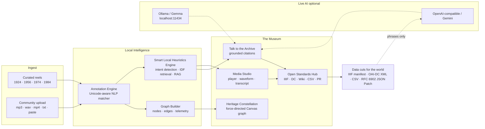

<div align="center">

# 🕰️ SmritiGraph — The Living Archive

**A cultural context decoder, knowledge-graph and open-standards export hub for Karnataka's endangered audiovisual heritage.**
Built for **Hacktoberfest Hack Day 2026 · Track 2 · Audiovisual Heritage Day**.

<span>


</span>

</div>

---

## 🎞️ The problem we're solving

Karnataka's tape archives — Akashvani radio discs, Doordarshan U‑matics, Janapada field cassettes — are digitizing fast, but **digitization is not the same as comprehension**. A 1924 transcription is full of terms a modern listener can't parse: *ಕನ್ನಡ ರಾಜಯೊಗ*? *Suvarna Karnataka*? *Bayalata*? What does "Satellite Instructional Television" have to do with Belgaum's Congress session? Where a heritage file says `source: AIR Dharwad` and nothing else, a researcher is stuck.

SmritiGraph sits **on top of the digitized reel** and computes three things, live, in the browser:

1. **Decode it** — every cultural term, place name and historical figure gets a Context Card: literal meaning, cultural meaning, era, region, and 100 years of evolution.
2. **Connect it** — the term is woven into an interactive knowledge graph spanning people ↔ places ↔ traditions ↔ institutions ↔ reels.
3. **Liberate it** — the reel + decoded annotations are emitted as **IIIF 3.0 JSON‑LD, Dublin Core (JSON/XML), Wikimedia Markdown, bulk CSV** — the formats that real GLAM (Galleries, Libraries, Archives, Museums) pipelines ingest the same day. And anyone — a grandparent in Dharwad, a student in Belagavi — can submit a missing term as a **ready-to-merge GitHub Pull Request** without touching Git.

> **Track‑2 thesis:** heritage ends where context begins. We don't just preserve the file — we preserve the *understanding of the file*, in open standards anyone can use, forever.

---

## 🧭 Architecture



**The deterministic guarantee:** the Live-LLM path (dashed) is *advisory*. Every feature above works with the network on or off, no key, on first click. When the model is unreachable, the **Local Heuristics Engine** answers from a seeded inverted-index + IDF retrieval, and a toast politely tells you so. Nothing ever throws at the user — the archive never sleeps.

### What ships pre-loaded

| Reel | Year | What it actually is |
| --- | --- | --- |
| **Belgaum Congress Session & Freedom Movement** | 1924 | Staged vision of the INC Belgaum session — the reel where Gandhi's vision meets Karnataka's soil |
| **Suvarna Karnataka Unification Radio Broadcast** | 1956 | AIR Dharwad/Mysore transmission marking the linguistic unification of the Kannada state |
| **Bayalata & Janapada Oral Folklore Recording** | 1974 | Field cassette from Bailhongal taluk — open-air theatre, dialect, oral recall |
| **SITE Broadcast (Doordarshan Kendra Bangalore)** | 1984 | The satellite-instructional TV experiment's vision, decoded from a restored U-matic |

All four ride the **virtual playback clock** with deterministic waveforms and frame-accurate citations, so the demo is reproducible in front of judges. Pressing **Play** starts a synthesised tape bed (pink-noise hiss + 50 Hz projector hum + slow flutter) and the browser's speech engine **reads each transcript passage aloud** — the **Narrate** toggle mutes the voice while the ambience continues. Any media file you upload plays through the real Web Audio pipeline instead, with no narration layered on top.

---

## ✨ The four rooms of the museum

### 1 · Media Studio & Decoder
Split-pane creation aesthetic: archival screen (with **film-grain**, **vignette** and a **restoration toggle**) beside a live generated waveform. The timestamped transcript annotates **every recognized cultural term** in place — click a gold-highlighted phrase and its Cultural Context Card opens: literal meaning, cultural meaning, era, region, historical evolution, plus every other reel where the same term appears (cross-reel "echoes", clickable to seek).

### 2 · Heritage Constellation
A hand-built `Canvas` force-directed graph (no graph libraries — physics iterations, edge springs, node repulsion). Nodetypes encode by color: **people** (gold), **places** (aqua), **traditions/idioms** (violet), **events** (coral), **institutions/technology** (indigo), **reels** (emerald). Click any node → the inspector drawer shows neighbors (clickable to hop), attachment to reels, and the full cultural gloss. Filter chips prune per type; telemetry shows live node/edge counts.

### 3 · Talk to the Archive
Grounded RAG chat. Four judge-ready demo prompts ship in the panel: they run **fully offline** through the Local Heuristics Engine. Live-model users get the same grounding — only the phrasing is outsourced (we never let a model freestyle heritage facts). Every answer carries **reel + timestamp + confidence citations**; click one and the app jumps to the Media Studio, seeks to that moment and flashes the source segment.

Uploaded reels start silent: the empty transcript panel offers **Transcribe audio on this device** — `whisper-tiny.en` quantized, compiled to WebAssembly, with weights (`public/models`) and the ORT runtime (`public/ort`) served from this repo. Timestamps feed the synchronized transcript, after which the full offline annotator, graph and RAG pipeline pick it up automatically. English speech works best; nothing leaves the browser.

### 4 · Open Standards Hub
One artifact at a time for the active reel, previewable, copyable, downloadable:

| Artifact | Format |
| --- | --- |
| IIIF manifest | **Presentation API 3.0** JSON‑LD — canvas, media body, rights, timed transcript annotations, a local 6-point validation badge |
| Dublin Core | 1.1 elements as **JSON-LD** *and* schema-mirroring **OAI-DC XML** |
| Wikimedia Companions page | Markdown with transcript table, annotations with timestamps, suggested categories |
| Annotation dataset | **CSV** (RFC 4180) covering the *whole* archive, not one reel |
| Crowdsourced annotation | Form → **GitHub PR payload** with RFC 6902 **JSON Patch** + ready-made compare URL |

Plus **npm / Python / cURL consumption snippets**, a live-validated **Openness Compliance ring** that climbs as you ship artifacts (watches your own downloads!), and spec links directly from the hub.

---

## 🚀 Quick start

```bash
git clone https://github.com/smritigraph/smritigraph.git
cd smritigraph
npm install
npm run dev          # → http://localhost:5173
```

No accounts, no keys, no model server. It renders and answers on `npm install` alone.

**Production build:** `npm run build` → `dist/` (verified: ~370 kB JS, 117 kB gzip).

---

## 🦙 Fully-local LLM (Ollama · Gemma) — optional but lovely

SmritiGraph's brain is hard-coded local-first, but it will phrase answers through any OpenAI-compatible endpoint when you turn one on:

```bash
# 1. Install Ollama — https://ollama.com/download
ollama --version

# 2. Pull a light model (Gemma works beautifully for Indian-English heritage prose)
ollama pull gemma3:4b        # ~3 GB; try gemma3:1b on laptops
ollama serve                 # listens on http://localhost:11434 (default)

# 3. In the app — press the ⚙ chip in the header, pick a provider:
#    Ollama (localhost:11434) · OpenAI-compatible · Gemini API · Local Heuristics
#    Hit Test connection → a green toast confirms, a coral toast falls back safely.
```

White glove notes:

- Model responses are **always grounded with Local Heuristics retrieval first** — the model rephrases real reel citations; it may *never* invent one.
- Provider settings persist in `localStorage` (`smritigraph.settings.v1`).
- No server mode. This is a browser app; your reel data never leaves your machine. The `fetches` for uploads stay entirely in-browser too (object URLs).

---

## 🪔 What's a IIIF? (and why it's on the receipt)

**IIIF — the International Image Interoperability Framework** — is the open standard most of the world's cultural institutions (British Library, Vatican, Smithsonian) use to present collections with *shared, replaceable viewers*. Presentation 3.0 extends it to **audio/video**: a manifest says *"this reel is a canvas, this canvas contains that media, at `t=…` these transcript bodies overlay it, under this rights statement."*

Because SmritiGraph emits a valid Presentation 3.0 manifest *with timed annotation bodies*, the reel can be replayed—with its decoded cultural glossary—in Mirador, Universal Viewer or any IIIF player that exists today or will exist in 2050. **The museum outlives us.** The companion OAI-DC record means indexes like Google Cultural Institute and library discovery layers can ingest the same resources without transformation.

---

## 📂 Repo layout

```
smritigraph/
├── src/
│   ├── data/
│   │   ├── reels.js          # 4 curated reels — full scripted transcripts
│   │   ├── dictionary.js     # 34-entry cultural dictionary (the "Smriti")
│   │   └── graph.js          # gazetteer + curated cross-reel edges
│   ├── engine/
│   │   ├── analyze.js        # Unicode-aware term matcher · graph builder · metrics
│   │   ├── rag.js            # corpus · IDF retrieval · intents · grounded prompting
│   │   ├── llm.js            # providers · never-throw LLM client
│   │   └── exporter.js       # IIIF · DC · Wiki · CSV · PR payload generators
│   ├── components/           # 12 components — every tab, modal, canvas
│   ├── store.jsx             # single flight-safe provider + playback pub-sub
│   ├── utils/toolkit.js      # time, download, copy, slug helpers
│   └── App.jsx / main.jsx / index.css
├── package.json  vite.config.js  tailwind.config.js  index.html
├── README.md  CONTRIBUTING.md  LICENSE
```

---

## 🤝 Contributing

Eager for you — especially for **cultural dictionaries** in languages we haven't touched yet, for regional **archival connectors**, and for new **export formats** (EAD? METS? Frederic? Spectral?). Start at [`CONTRIBUTING.md`](CONTRIBUTING.md) — the guide has a walkthrough specifically for first-time Hacktoberfest contributors, including how the annotation-PR generator means *you* can add to the archive **from inside the app in one screen**.

## 📜 License

MIT — code. Content annotations carry CC BY 4.0 to stay compatible with Wikimedia's ecosystem. See [`LICENSE`](LICENSE).
